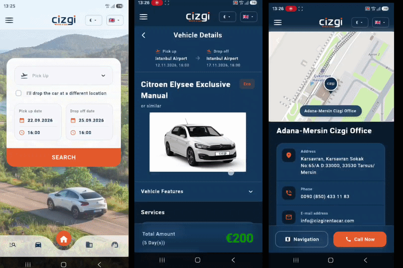

# Çizgi Rent A Car - Mobile App Showcase 

*Note: Due to non-disclosure agreements (NDA) and commercial copyrights, the source code of this project is kept private. This repository serves as a professional showcase of my contributions to the application.*

## About The Project

This application was developed during my summer internship (between my 2nd and 3rd year of Software Engineering at Muğla Sıtkı Koçman University) at **Mızraklı Group IT Department**. 

I single-handedly built the entire frontend architecture, cross-platform UI/UX designs, navigation flows, and local state management using **Flutter** and **Dart**. The application features a complete end-to-end vehicle booking funnel, customized drawer structures, dynamic theme switching (Dark/Light), and multi-language support. After delivering the fully functional application structure, the Mızraklı Group IT team handled the final API integrations and deployed the application to the respective app stores.

### My Contributions & Technical Details
* **Complete UI/UX Implementation:** Designed and coded all screens, ensuring a responsive and native-like experience on both iOS and Android.
* **State Management:** Implemented `Provider` for robust state handling across the application.
* **Localization & Theming:** Configured `flutter_localizations` for multi-language support and built a dynamic light/dark theme engine.
* **Booking Funnel:** Developed the complex user journey for selecting vehicles, choosing dates, and completing reservation steps.

## Application Preview

*(The GIF above demonstrates the core navigation, UI components, and the reservation flow I developed.)*

---

<b>🇹🇷 Türkçe (Turkish) Oku </b>

## Proje Hakkında

Bu uygulama, **Muğla Sıtkı Koçman Üniversitesi Yazılım Mühendisliği** 2. ve 3. sınıf arasındaki yaz stajım kapsamında, **Mızraklı Group IT Departmanı** için geliştirilmiştir.

Uygulamanın tüm ön yüz mimarisini, çapraz platform UI/UX tasarımlarını, navigasyon akışlarını ve durum yönetimini (state management) **Flutter** ve **Dart** kullanarak tek başıma geliştirdim. Uygulama; uçtan uca araç rezervasyon hunisi, özelleştirilmiş menü (drawer) yapıları, dinamik tema yönetimi (Karanlık/Aydınlık) ve çoklu dil desteği içermektedir. Tamamen işlevsel olan bu yapı tarafımca teslim edildikten sonra, canlı verileri çeken API entegrasyonları Mızraklı Group ekibi tarafından tamamlanmış ve uygulama mağazalarında yayına alınmıştır.

### Katkılarım ve Teknik Detaylar
* **Kapsamlı UI/UX Geliştirmesi:** iOS ve Android cihazlarda duyarlı (responsive) ve akıcı bir deneyim sunmak üzere tüm ekranlar kodlandı.
* **Durum Yönetimi (State Management):** Uygulama içi veri akışını güvenli bir şekilde yönetmek için `Provider` mimarisi kuruldu.
* **Çoklu Dil ve Tema:** `flutter_localizations` ile dil desteği ve dinamik karanlık/aydınlık tema motoru entegre edildi.
* **Rezervasyon Akışı:** Araç seçimi, tarih belirleme ve kiralama adımlarını içeren karmaşık kullanıcı yolculuğu (user journey) tasarlandı ve uygulandı.

## Uygulama Önizlemesi

*(Yukarıdaki GIF, tarafımca geliştirilen temel navigasyonu, arayüz bileşenlerini ve rezervasyon akışını göstermektedir.)*

